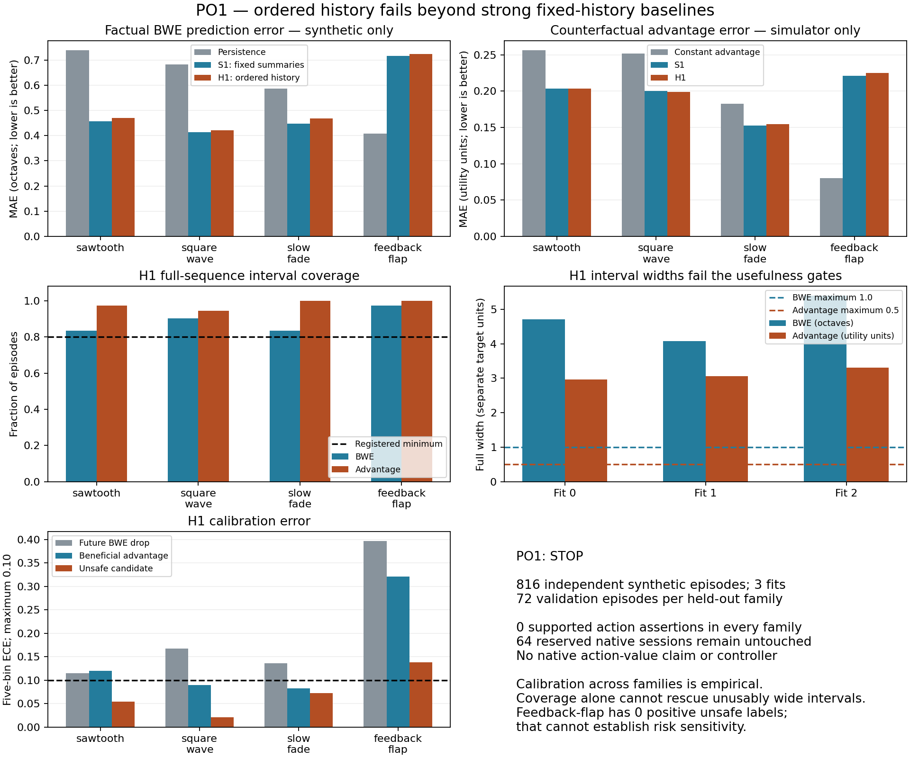

# PO1 result: stop the bounded history-information route

## Decision

**Qualified negative screen:** all 816 planned synthetic episodes completed;
all four held-out generator families failed the frozen acceptance conjunction.
Do not expand the representation, refit/tune thresholds, train a recurrent
model, fit/promote a controller or start a safe-policy efficacy study from PO1.
The 64-session fresh native factual reservation remains unopened under the
registered sequential stop rule. There is **no native predictive result** here.

IF1 remains a practical build-admission failure with no compiler attempt, not
scientific evidence against instrumented Chromium. M5's native causal-history
evidence, M6R–M11R negatives, V13's unopened actions, V10's closed policy, all
old freezes and other untouched allocations remain unchanged. All 1,667 files
tracked at d0b4467 were SHA-256 checked against the anchor and remain unchanged.

## Preregistration and execution

- Registration commit: `d43d407`; protocol and exact seed allocation are in
  `data/partial-observability-po1/registration.json`.
- 816 unique episode seeds and unique complete exogenous-trace hashes; 30 sealed
  raw shards, three independently fitted seed batches,12 model bundles.
- 384 fitting episodes, 144 calibration episodes, 288 held-out validation episodes;
  six correlated decisions/episode. All 4,896 original decision rows retained;
  inference resamples whole episodes within fit, never independent holds.
- Fitting, calibration and validation generator families are disjoint. Source
  functions are previously used synthetic definitions with fresh episodes, not
  newly sourced measurements or independent simulator implementations.
- Model/calibrator checksums were locked before validation was decoded for
  analysis. No tuning, replacements, failed collectors or post-hoc candidates.
  Every train/calibration binary head met the frozen positive/negative support
  requirement, and every optimization completed. This is an estimable negative,
  not an empty-class or acquisition failure.
- Features were snapshotted before branching; past-cutoff, original-state
  nonmutation and role/trace-disjointness assertions all passed. No future trace,
  capacity, hidden queue, receiver QoE or source ID entered a model input.
- The pre-generation, uncommitted fixed0.65 logging draft is retained with its
  analytic application-limitation diagnosis and source snapshots. It generated
  zero episodes. The final registration uses the prior synthetic fixed1.05
  logger; it does not retune the frozen native fixed0.65 baseline.

The simulator uses a fluid bottleneck, a simplified AckedBwe estimator, assumed
encoder response, and a common fixed governor. Logging holds1.05. Offline
action labels compare0.65 for5s with1.05 for3s then0.65 for2s, including the
existing utility/switch/safety definitions. Factual BWE targets use continuation
of the logging regime1.05 for5s. They are separate labels with separate meaning.

## Point prediction and reproducibility

S1 is the frozen strong linear baseline: current values/masks plus past3s means,
slopes and missing fractions of five observable channels. H1 adds only their
ordered1/2/3s snapshots/masks. Both use fixed ridge penalties and train-only
standardization. No policy is fitted and no learned action is executed.

Each row below contains 72 validation episodes across three separate fits.
BWE error is in log2 octaves; advantage error is in simulator utility units.

| Held-out family | BWE persistence MAE | BWE S1 | BWE H1 | Advantage constant MAE | Advantage S1 | Advantage H1 |
| --- | ---: | ---: | ---: | ---: | ---: | ---: |
| sawtooth |0.740 |0.457 |0.469 |0.256 |0.204 |0.203 |
| square_wave |0.684 |0.413 |0.421 |0.251 |0.200 |0.199 |
| slow_fade |0.587 |0.447 |0.469 |0.183 |0.152 |0.154 |
| feedback_flap |0.407 |0.716 |0.724 |0.080 |0.221 |0.225 |

There is useful average predictive information relative to persistence/current
values in the first three families. It does **not** transport robustly: H1
loses to S1 for factual BWE in every family, and feedback-flap H1 BWE error is
77.8% worse than persistence. In that family, H1 advantage error is179.4% worse
than the train-only constant advantage estimate. S1 also fails on feedback-flap;
these data do not justify promoting S1 as a robust substitute.

Paired absolute MAE improvement of H1 over S1 (positive is better), with the
registered within-fit episode bootstrap5th–95th percentile bounds:

| Family | BWE improvement [bounds] | Advantage improvement [bounds] |
| --- | --- | --- |
| sawtooth |−0.01278 [−0.01890, −0.00674] |+0.00040 [−0.00249, +0.00332] |
| square_wave |−0.00813 [−0.01326, −0.00283] |+0.00087 [−0.00133, +0.00303] |
| slow_fade |−0.02158 [−0.02602, −0.01715] |−0.00190 [−0.00399, +0.00020] |
| feedback_flap |−0.00821 [−0.01562, −0.00099] |−0.00379 [−0.00672, −0.00087] |

The tiny first-two-family advantage gains are0.19% and0.43%, below the frozen5%
requirement, their lower bounds cross zero, and each reverses in at least one
fit. No family meets the requirement to improve both targets over every
applicable baseline. All baseline/fit comparisons, not only S1, are retained in
`reports/partial-observability-po1-result.json`. Bounds condition on these three
fixed fits; they do not quantify uncertainty over simulator implementations or
all possible network families. No pooled mean rescues a failed family.

## Calibration, uncertainty and safety

The nominal90% intervals were calibrated using maximum absolute residual over
all six decisions of each calibration episode. Calibration uses separate
families and supplies no distribution-free guarantee under family shift.

| Family | H1 BWE sequence coverage | H1 advantage sequence coverage | BWE-drop ECE | Benefit ECE | Unsafe ECE |
| --- | ---: | ---: | ---: | ---: | ---: |
| sawtooth |83.3% |97.2% |0.115 |0.120 |0.055 |
| square_wave |90.3% |94.4% |0.168 |0.090 |0.020 |
| slow_fade |83.3% |100% |0.136 |0.082 |0.073 |
| feedback_flap |97.2% |100% |0.397 |0.321 |0.138 |

Coverage cannot be considered alone: H1 full BWE interval widths are 4.712,
4.077 and 5.401 octaves across fits, versus the frozen maximum 1.0. Advantage
widths are 2.962, 3.063 and 3.308 utility units, versus maximum 0.50. Every family
fails useful uncertainty because of these widths. The lowest within-fit coverage
is 75% and meets that component of the frozen
gate; the complete per-fit table is preserved in the machine-readable report.

Every family fails the binary-calibration conjunction. Feedback-flap BWE-drop
and benefit Brier losses are0.384/0.345 versus constant0.282/0.313, with large
ECE. Its432 validation rows contain zero positive unsafe-candidate labels;
99.8% unsafe-class accuracy does not establish risk sensitivity. Other families
retain57,26 and14 positive unsafe labels respectively; do not pool them to fill
the feedback-flap event gap.

There are **zero supported action assertions in every family**, since the
frozen advantage lower bound, benefit-confidence and risk conditions do not
jointly qualify. This fails the minimum30 asserted episodes/family. Zero
assertions is insufficient supported discrimination, not demonstrated safety.
The Wilson upper error bound is explicitly1.0 when the assertion count is zero.
No assertions were executed as actions, and no learned policy was evaluated.



## Scope and stopping decision

PO1 establishes a bounded failure of this compact ordered-history increment and
its calibration transport in one simulator, despite some predictive signal
relative to weaker baselines. It does not show that all observable history is
irrelevant, refute M5, settle native identifiability, or evaluate instrumented
Chromium. No native factual target, receiver outcome, counterfactual value or
control benefit was inferred from simulator results.

Apply the registered stop. Keep the fresh native allocation untouched; no
native technical qualification or empirical prediction result is claimed.
Do not spend that panel to rescue this representation, increase model complexity,
add features on PO1 validation, change the calibrator, weaken thresholds or
register a safe-policy efficacy panel from this result. A future change in the
research question would need separate scientific justification, fresh data and
preregistration. No successor controller or further feature search is proposed.

## Preservation and reproducibility

Scientific commands, in registered order:

```sh
python tools/partial_observability_po1.py verify
python tools/partial_observability_po1.py collect
python tools/partial_observability_po1.py lock_models
python tools/partial_observability_po1.py analyze
```

Collection/refitting/analysis refuse replacement. Existing outputs are preserved;
the commands describe provenance, not authorization to overwrite a closed run.
Raw shards must pass their registered size/SHA-256 checks before decoding;
model hashes and the validation-open lock bind the analysis. Raw data, models,
predictions, superseded draft, source snapshots and this report are preserved
privately with a pinned revision and fresh object/member verification. Local
raw evidence is retained. See
`docs/storage-receipts/partial-observability-po1-20261015-01.json` for exact hashes.
